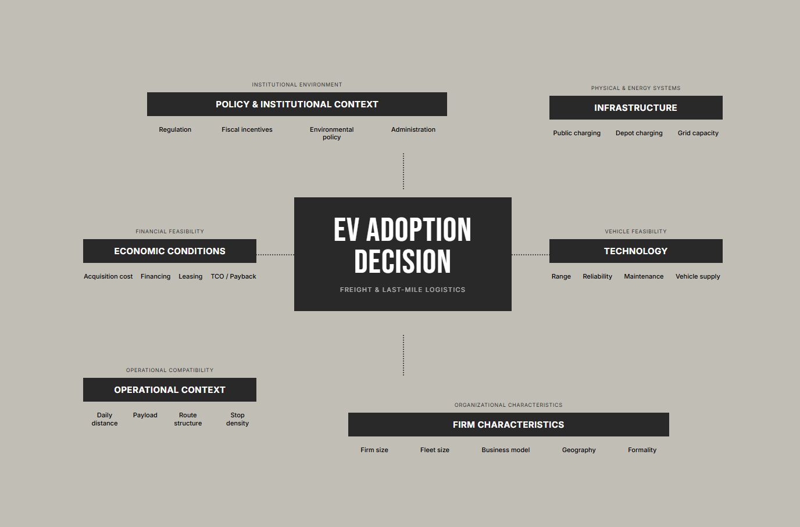

# Electromobility in Mexico: Last-Mile Delivery and Freight Transport

Research and data science project exploring the conditions that influence the adoption of electric vehicles (EVs) in freight transportation and last-mile logistics in Mexico.

The project combines **policy and regulatory analysis, firm-level survey data, qualitative evidence, and data-driven methods** to better understand the economic, operational, infrastructural, regulatory, and organizational factors shaping fleet electrification.

> **Status:** Work in progress.

> _The research questions, analytical framework, and empirical scope may evolve as additional evidence and datasets are incorporated._

---

## Research Motivation

Mexico is undergoing an important transition toward electromobility, supported by national decarbonization objectives, emerging EV manufacturing capabilities, and growing interest from logistics and transportation companies. However, **EV adoption in freight transportation and last-mile delivery remains uneven**.

This project investigates how these factors interact and which combinations of conditions may meaningfully accelerate EV adoption in Mexico's logistics sector.

---

## Working Research Question

The current overarching research question is:

> **What regulatory, fiscal, energy, environmental, administrative, economic, and operational conditions are sufficient to accelerate the adoption of electric vehicles in freight transportation and last-mile logistics?**

This question is intentionally broad at the current stage of the project and may later be divided into more specific empirical research questions.

Current sub-questions include:

1. **Barriers and enablers**
   What factors most strongly encourage or discourage EV adoption among last-mile delivery operators?

2. **Firm heterogeneity**
   How do fleet size, delivery model, geographic scope, vehicle type, and organizational characteristics affect EV adoption readiness?

3. **Economic feasibility**
   What acquisition costs, financing conditions, operating costs, and investment thresholds influence firms' willingness to electrify their fleets?

4. **Charging infrastructure**
   How do operators evaluate public, depot-based, home, and alternative charging strategies?

5. **Policy effectiveness**
   Which regulatory, fiscal, energy, environmental, and administrative measures appear most relevant for reducing barriers to fleet electrification?

---

## Project Objectives

The project aims to:

- Identify the main barriers and enablers affecting EV adoption in Mexican freight and last-mile logistics.
- Analyze how adoption conditions differ across firms, fleet sizes, vehicle types, and operating models.
- Evaluate the role of financing, leasing, operating costs, and total cost of ownership.
- Study the availability and perceived adequacy of charging infrastructure.
- Examine Mexico's regulatory, fiscal, energy, environmental, and administrative framework for electromobility.
- Compare firm-level perceptions with existing policies and modeled technological or economic feasibility.
- Identify combinations of interventions that could create favorable conditions for EV adoption.
- Develop reproducible analytical workflows for electromobility research.
- Explore future applications of **data science, machine learning, optimization, and decision-support systems** for fleet electrification.

---

## Research Framework

The project considers EV adoption as a multidimensional decision problem.

Conceptually:



Rather than assuming that one factor—such as vehicle price or driving range—determines adoption, the project studies the interaction among these dimensions.

---

## Data

The empirical work currently includes firm-level information from Mexican companies involved in freight transportation and last-mile delivery.

Variables include, among others:

### Company characteristics

- company size,
- geographic scope,
- delivery model,
- operational regions,
- fleet size.

### Fleet characteristics

- vehicle types,
- ownership structure,
- leasing share,
- vehicle utilization,
- daily distance,
- delivery volumes.

### Economics

- acquisition costs,
- financing preferences,
- interest rates,
- leasing,
- fuel expenditure,
- maintenance expenditure,
- operating costs.

### Electromobility

- current EV ownership,
- willingness to adopt EVs,
- perceived advantages,
- perceived disadvantages,
- infrastructure constraints,
- charging preferences.

### Policy and institutional context

The project also documents Mexican:

- laws,
- regulations,
- fiscal provisions,
- electricity-sector rules,
- environmental regulations,
- mobility policies,
- technical standards,
- government strategies,
- incentives,
- and administrative requirements

that may directly or indirectly affect electromobility.

> Raw datasets may not be publicly available where confidentiality, privacy, licensing, or research agreements apply.

---

## Methodology

The project follows an interdisciplinary research approach combining:

### Literature Review

Systematic collection and classification of research related to:

- EV adoption,
- freight electrification,
- last-mile logistics,
- total cost of ownership,
- charging infrastructure,
- environmental impacts,
- logistics optimization,
- policy instruments,
- and electromobility in emerging markets.

### Regulatory and Policy Analysis

Identification and verification of Mexican legal and policy instruments relevant to electromobility.

Each instrument is evaluated in terms of:

- jurisdiction,
- legal status,
- applicability,
- responsible authority,
- target actors,
- incentives or obligations,
- implementation mechanisms,
- and relevance for freight electrification.

### Qualitative Research

Semi-structured interviews are used to investigate how logistics operators interpret:

- operational feasibility,
- EV reliability,
- charging availability,
- financing,
- investment risk,
- maintenance,
- public policy,
- and fleet electrification strategies.

### Quantitative Analysis

Survey responses are analyzed through:

- exploratory data analysis,
- descriptive statistics,
- segmentation,
- cross-tabulation,
- statistical modeling,
- and visualization.

### Machine Learning

Exploratory predictive models may be used to investigate the relationship between firm characteristics and EV adoption consideration.

Models evaluated may include:

- Logistic Regression,
- L1-Regularized Logistic Regression,
- Decision Trees,
- and additional interpretable models where appropriate.

The purpose of these models is primarily **explanatory and exploratory**, rather than production-scale prediction.

---

## Current Analytical Dimensions

The project currently organizes EV adoption determinants into several connected dimensions:

| Dimension      | Example factors                                            |
| -------------- | ---------------------------------------------------------- |
| Economic       | EV price, fuel savings, TCO, interest rates, leasing       |
| Operational    | Distance, payload, delivery density, route structure       |
| Infrastructure | Depot charging, public charging, grid capacity             |
| Technological  | Range, vehicle availability, reliability, maintenance      |
| Regulatory     | Vehicle standards, mobility regulation, permitting         |
| Fiscal         | Tax deductions, exemptions, incentives                     |
| Environmental  | Emission reduction policies and targets                    |
| Administrative | Permits, utility procedures, infrastructure approvals      |
| Organizational | Fleet size, sustainability strategy, risk tolerance        |
| Behavioral     | Manager perceptions, technology confidence, range concerns |

---

## Repository Structure

The repository follows reproducible research and data science practices inspired by **The Turing Way** and **Cookiecutter Data Science**.

```text
electromobility-mexico/
│
├── README.md
├── LICENSE
├── CITATION.cff
├── .gitignore
├── requirements.txt
│
├── data/
│   ├── raw/
│   ├── interim/
│   ├── processed/
│   └── external/
│
├── notebooks/
│   ├── 01_data_cleaning/
│   ├── 02_exploratory_analysis/
│   ├── 03_statistical_analysis/
│   ├── 04_machine_learning/
│   └── 05_visualization/
│
├── src/
│   ├── data/
│   ├── features/
│   ├── analysis/
│   ├── models/
│   └── visualization/
│
├── research/
│   ├── literature/
│   ├── regulation/
│   ├── policy/
│   ├── interviews/
│   └── research_questions/
│
├── reports/
│   ├── figures/
│   ├── tables/
│   ├── drafts/
│   └── final/
│
├── references/
│   ├── bibliography/
│   └── legal_sources/
│
└── docs/
```

---

## Research Roadmap

### Phase 1 — Literature and Context

- [x] Review electromobility literature
- [x] Review last-mile logistics literature
- [x] Identify EV adoption barriers and enablers
- [x] Develop preliminary conceptual framework
- [ ] Expand comparative international literature

### Phase 2 — Mexico Regulatory Framework

- [x] Identify relevant Mexican legislation
- [x] Map fiscal and regulatory incentives
- [x] Review electricity and charging regulations
- [ ] Build structured policy database
- [ ] Evaluate policy implementation gaps

### Phase 3 — Firm-Level Evidence

- [x] Conduct qualitative interviews
- [x] Collect company survey responses
- [x] Clean and standardize survey data
- [x] Perform exploratory analysis
- [x] Test interpretable classification models
- [ ] Expand statistical analysis

### Phase 4 — Integrated Analysis

- [ ] Connect policy conditions with firm-level barriers
- [ ] Identify operator archetypes
- [ ] Compare adoption readiness across segments
- [ ] Estimate combinations of favorable adoption conditions
- [ ] Develop an integrated EV adoption framework

### Phase 5 — Decision-Support Tools

Future extensions may include:

- EV adoption readiness scoring,
- fleet electrification recommendation systems,
- total cost of ownership calculators,
- vehicle-route compatibility analysis,
- charging infrastructure optimization,
- scenario simulation,
- and interactive policy dashboards.

---

## Potential Future Research

The long-term goal is to extend the project beyond descriptive analysis toward a **data-driven decision-support framework for fleet electrification**.

Possible research directions include:

### EV Adoption Readiness Index

Estimate the readiness of a company or fleet based on its:

- operating profile,
- financial conditions,
- charging access,
- route characteristics,
- and policy environment.

### Fleet–Vehicle Matching

Recommend suitable electric vehicle types according to:

- payload,
- daily distance,
- number of stops,
- charging opportunities,
- and route topology.

### Policy Scenario Simulation

Estimate how EV adoption could change under alternative interventions such as:

- acquisition subsidies,
- tax incentives,
- preferential financing,
- charger subsidies,
- electricity tariffs,
- low-emission zones,
- or accelerated depreciation.

### Cross-Country Comparison

Future work may compare Mexico with other markets, particularly:

- United States,
- Colombia,
- and other Latin American economies.

This would make it possible to study how different regulatory and market environments influence fleet electrification.

---

## Reproducibility

This repository aims to follow reproducible research practices.

Where permitted, the project will provide:

- documented data-processing pipelines,
- reproducible notebooks,
- dependency specifications,
- source references,
- analytical assumptions,
- and version-controlled research outputs.

Sensitive or confidential company-level information will not be publicly distributed.

---

## Limitations

The project is exploratory and evolving.

Current limitations may include:

- relatively small firm-level samples,
- non-random sampling,
- self-reported survey responses,
- heterogeneous company profiles,
- limited availability of operational fleet data,
- incomplete information about informal operators,
- and rapidly evolving EV policies and technologies.

Results should therefore be interpreted as evidence about **patterns, mechanisms, and decision factors**, rather than as nationally representative estimates of EV adoption.

---

## Project Status

🟡 **Active Research**

Current work focuses on integrating:

```text
Firm-Level Evidence
        +
Economic Conditions
        +
Operational Feasibility
        +
Charging Infrastructure
        +
Policy & Regulation
        ↓
Understanding EV Adoption
in Mexico's Last-Mile Logistics
```

---

## License

Code, documentation, data, and research outputs may require different licenses depending on their origin and confidentiality restrictions.

Licensing information will be documented as the project develops.

---

## Citation

If this repository contributes to an academic publication, formal citation information will be added through a `CITATION.cff` file.

---

## Acknowledgements

> This repository uses the template created and maintained by _The Turing Way_ team members and shared under CC-BY 4.0 for reuse: https://github.com/alan-turing-institute/reproducible-project-template.

---

## Contact

For questions, research collaboration, or feedback, please open an issue in this repository.
